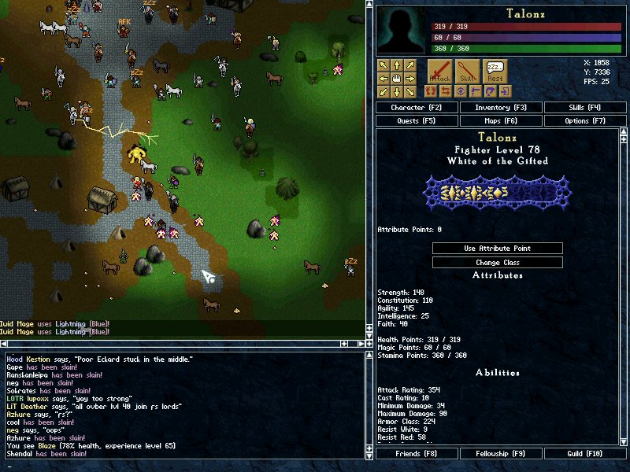
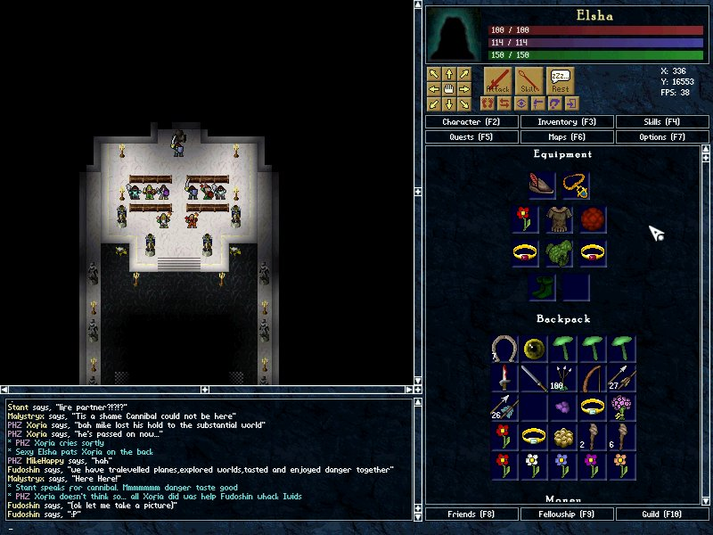
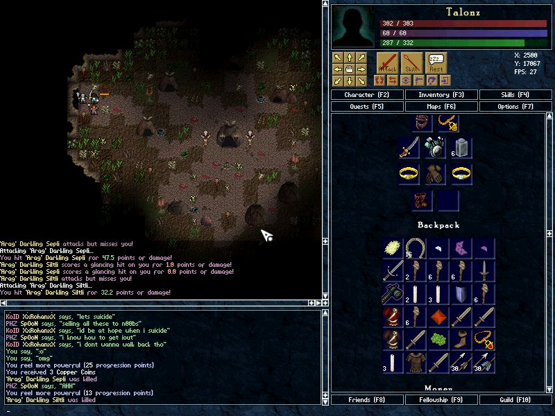
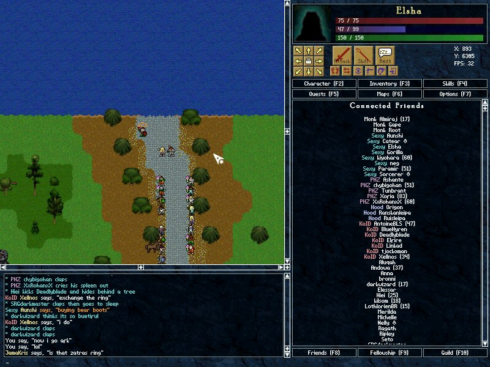

# Akarrian Encyclopedia

Visit [apedia.talonz.com](https://apedia.talonz.com) to view the deployed site.

This is a very old website that I took over maintenance for from a person who
went by the in-game name "Trance" way back in June 2003. It was the primary
reference site for a 2D multiplayer online fantasy role-playing game called
[Whispers in
Akarra](https://web.archive.org/web/20040325013734/http://akarra.net/), the game
itself a hobby project created by [Jens
Bergensten](https://en.wikipedia.org/wiki/Jens_Bergensten), best known as
the lead developer and designer of Minecraft.

I have since rebuilt the "Apedia" as it was affectionately called as a static
SvelteKit site hosted on GitHub Pages. The design stays true to the original,
but it now works on mobile, and its pages have been reorganized and updated for
the shards that are played today. If you're curious about the old web, the
original pages are kept in [old/](/old), including [the home
page](/old/index.php) and [the DHTML drop-down menu](/old/scripts/menu.js).

## Screenshots

### First wave of monsters in a special event

### The Purple Haze clan is founded

### A darkling village

### The first in-game wedding

